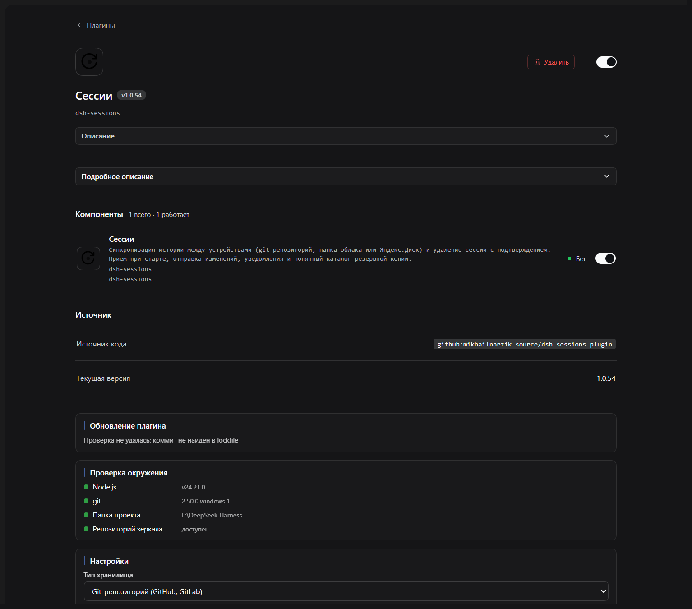

# Сессии

Плагин «Сессии» для DeepSeek Harness делает две вещи: переносит историю
диалогов между компьютерами и добавляет удаление сессии с подтверждением.

Сессия — это один диалог с агентом: сообщения, картинки, приложенные файлы и
папка проекта, в которой шла работа. По умолчанию всё это хранится только на
одном компьютере. Плагин делает копию истории («зеркало») в выбранном месте и
подтягивает её на других устройствах. Удалённая сессия так же уезжает в
зеркало и исчезает на остальных компьютерах.



*Страница плагина в интерфейсе DSH. Скриншот прежнего оформления: страница
синхронизации теперь центрируется по окну и собрана из карточек.*

## Что это и зачем

- **Синхронизация.** История диалогов остаётся одинаковой на всех ваших
  устройствах: дома, на работе, на ноутбуке. Плагин сам принимает изменения
  при запуске DSH и отправляет новые, когда вы работаете.
- **Удаление.** В меню сессии появляется пункт «Удалить сессию». Перед
  удалением плагин показывает связанные сессии и просит подтвердить действие
  словом `delete`.
- **Понятная резервная копия.** В зеркале у каждой сессии лежит
  `session.json` с названием и датой, а в папке проекта `sessions/<проект>/` —
  `index.md` со списком сессий. Это можно открыть даже без DSH.
- **Резервное хранилище.** Можно указать второе место: сессии уедут в оба, а
  если основное недоступно, приём пойдёт из резервного.

Термины простыми словами:

- **Хранилище** — место, где лежит копия: приватный git-репозиторий, папка
  облачного диска или Яндекс.Диск.
- **Зеркало** — сама эта копия с файлами сессий.
- **Идентификатор проекта** — короткое имя проекта (например, `harness`),
  одинаковое на всех устройствах. По нему сессии находят друг друга.
- **Вложения** — картинки и файлы из чата, которые тоже можно переносить.

Синхронизация и удаление — два независимых механизма. Если синхронизация не
настроена, удаление всё равно работает (и наоборот).

## Как открыть

1. Если плагин ещё не установлен, поставьте его через менеджер плагинов или
   командой `dsh plugin --profile desktop add github:mikhailnarzik-source/dsh-sessions-plugin`,
   затем перезапустите DSH.
2. В левой панели откройте **«Плагины»**.
3. Найдите карточку **«Сессии»** и откройте её страницу.
4. На странице плагина в разделе **«Синхронизация сессий»** — те же карточки
   настроек, что и на отдельной странице.

Быстрый путь: в левой панели есть отдельный пункт **«Синхронизация сессий»**.
Он открывает страницу с шапкой (иконка, название, статус-чип и кнопка
«Обновить») и карточками «Синхронизация», «Подключение», «Дополнительно»,
«Проверка окружения», «Обслуживание»; внизу — панель с кнопками «Сохранить»,
«Создать репозиторий» и «Диагностика». Контент страницы центрируется по окну:
колонка до 940 px с полями по краям (16 px на узком экране).

Удаление живёт в меню сессии: откройте меню у названия сессии в левой панели и
выберите **«Удалить сессию»**.

## Как пользоваться пошагово

### Включить синхронизацию через git-репозиторий

1. Создайте на GitHub **приватный** репозиторий, например `dsh-sessions`.
   Вся переписка будет лежать в нём, поэтому публичным его делать нельзя.
2. Откройте карточку плагина (см. «Как открыть»).
3. В поле «Тип хранилища» оставьте **«Git-репозиторий»**.
4. Вставьте адрес репозитория в поле «Адрес репозитория с сессиями (приватный)».
   Если репозитория ещё нет, нажмите **«Создать репозиторий»**: плагин создаст
   приватный репозиторий через токен GitHub из хранилища DSH.
5. Заполните «Путь к проекту на этом компьютере» (например, папку, где вы
   работаете) и «Идентификатор проекта» — короткое имя без пробелов.
6. При желании включите «Синхронизировать вложения (картинки и файлы из чата)».
7. Нажмите **«Сохранить»**, затем **«Синхронизировать»**.

Результат: в разделе «Проверка окружения» все строки зелёные, в «Синхронизации»
появился отчёт «принято/отправлено», а перед названиями сессий — зелёные точки.
Новые сессии, приехавшие с другого устройства, появятся в списке после
перезапуска DSH.

### Подключить второе устройство

1. Установите DSH и этот плагин на втором компьютере.
2. Откройте карточку «Сессии» и выберите то же хранилище (тот же репозиторий).
3. Укажите **локальный** путь к проекту на этом компьютере, а идентификатор
   проекта оставьте тем же, что и на первом.
4. Нажмите «Сохранить» и «Только принять» (или дождитесь автосинхронизации).
5. Перезапустите DSH — история появится в списке.

Результат: те же диалоги открываются на втором компьютере, и можно продолжить
любой из них.

### Удалить сессию

1. В левой панели откройте меню у названия ненужной сессии.
2. Выберите **«Удалить сессию»**.
3. Посмотрите, нет ли связанных (дочерних) сессий, и подтвердите удаление
   словом `delete`.
4. Если хотите, отметьте «Также удалить файлы, созданные этой сессией» — будут
   удалены только файлы, которые создала именно эта сессия.

Результат: сессия исчезает из списка, её копия остаётся в
`~/.dsh/dsh-sync/deleted/`, а удаление в течение нескольких секунд уходит в
зеркало и повторяется на других устройствах.

## Примеры

Адреса хранилищ:

| Что выбрано | Что вводить |
|---|---|
| Git-репозиторий | `https://github.com/you/dsh-sessions.git` |
| Папка облака | `C:\Users\you\YandexDisk\dsh-sync` или папка OneDrive |
| Яндекс.Диск (WebDAV) | логин без `@yandex.ru` и пароль приложения из `id.yandex.ru` |
| Яндекс.Диск через API | OAuth-токен с доступом к Диску |

Команды для проверки и починки (из папки плагина, на штатном Node):

```powershell
node cli.mjs status                 # что локально, а что в зеркале
node cli.mjs diagnostics            # отчёт о состоянии окружения
node cli.mjs repair                 # починить копии, созданные после конфликта
node cli.mjs prune-attachments      # убрать неиспользуемые вложения
node cli.mjs compact --months 36    # свернуть историю старше трёх лет
node cli.mjs device list            # какие устройства писали в зеркало
```

Фразы агенту:

- «Проверь состояние синхронизации сессий» — вызовет `sync_status`;
- «Синхронизируй сессии» — вызовет `sync_run`;
- «Только прими изменения» или «Только отправь» — `sync_run` с нужным режимом.

## Что вы увидите

- **Шапку страницы** — иконку синхронизации в круге, название, подзаголовок,
  статус-чип («настроено», «не настроено», «проверка…»), время последней
  синхронизации и кнопку «Обновить».
- **Карточку «Синхронизация»** — состояние зеркала, прогресс по основному и
  резервному хранилищу, кнопки «Синхронизировать», «Только принять», «Только
  отправить», последний запуск и историю.
- **Карточку «Подключение»** — тип хранилища, адрес репозитория (или папка
  Диска), путь и идентификатор проекта.
- **Карточку «Дополнительно»** — вложения, автообновление плагина и резервное
  хранилище (дублирование).
- **Карточку «Проверка окружения»** — строки со зелёной или красной точкой:
  Node.js, git, папка проекта, репозиторий зеркала, Яндекс.Диск.
- **Карточку «Обслуживание»** — версия плагина, доступное обновление и кнопка
  «Обновить».
- **Панель действий внизу** — «Сохранить», «Создать репозиторий»,
  «Диагностика».
- **Точку перед названием сессии**: зелёная — сессия совпадает с зеркалом,
  оранжевая — есть неотправленные изменения, красная — ещё ни разу не
  отправлялась.
- **Плашка у поля ввода** — «синхронизировано», «есть изменения» или
  «резерв N%»; при наведении показывает оба хранилища.
- **Всплывающие уведомления** в правом нижнем углу: красные — ошибка, синие —
  новая версия, зелёные — приняты новые сессии.
- **В зеркале** — `sessions/<проект>/<сессия>/session.json` рядом с логом,
  `sessions/<проект>/index.md` со списком сессий, `README.md` в корне и
  `projects.json` со списком проектов.
- После обновления плагина один раз показывается окно «что нового».

Кнопки — единая система: высота 36 px (в шапке 32), радиус 10, ширина по тексту;
primary («Синхронизировать», «Сохранить») — мягкая заливка brand 18% с рамкой
brand 55% и текстом brand, secondary — прозрачная с рамкой `border-l4`, danger —
мягкая красная заливка. Белого текста на белом фоне нет: в тёмной теме brand
белый, поэтому старые кнопки `button-primary-fill` не читались. Страница
центрирована до 960 px, строки кнопок переносятся, сетка/поля без фиксированных
ширин: 1280/1024/768/480 px перестраиваются без горизонтальной прокрутки, на
900 px — одна колонка, на 640 px — компактные поля. Диалог удаления сессии
использует те же кнопки.

## Частые ошибки и что делать

| Что видно | Что это значит и что делать |
|---|---|
| «не настроено» | Не заполнены адрес репозитория или путь к проекту. Заполните и нажмите «Сохранить». |
| «git не найден» | Установите git и перезапустите DSH. |
| «Репозиторий недоступен» | Нет сети, нет прав или адрес с опечаткой. Проверьте адрес и вход в GitHub. |
| «Яндекс.Диск: 401» | Для WebDAV нужен **пароль приложения**, а не пароль аккаунта; для API — действующий токен. |
| «Маршрут недоступен — перезапустите DSH» | Интерфейс обновился раньше host-части. Перезапустите DSH. |
| «Второй плагин синхронизации» | Установлен другой плагин синхронизации. Оставьте один движок, иначе два плагина будут писать в одно хранилище. |
| «Новых сессий не видно» | Перезапустите DSH: сессии регистрируются при старте. |
| «открыто: N» при приёме | Эти сессии открыты прямо сейчас, плагин их не трогает. Закройте DSH и повторите. |
| «конфликт» или копия сессии | Одну сессию правили на двух устройствах. Локальная остаётся, удалённая приезжает отдельной сессией — данные не теряются. |
| «Не удалось отправить» | Повторится само через минуту; проверьте сеть и «Диагностику». |

## Ограничения и безопасность

- Репозиторий и папка облака должны быть **приватными**: в сессиях лежит вся
  переписка, включая содержимое файлов. Шифрования содержимого нет.
- Секреты не пишутся в зеркало: git использует штатный менеджер учётных данных,
  пароли приложений WebDAV хранятся в защищённом хранилище секретов DSH,
  OAuth-токен Яндекс.Диска — в `~/.dsh/dsh-sync.json` на этом устройстве.
  GitHub-токен для «Создать репозиторий» берётся из хранилища секретов DSH.
- Новые сессии появляются в списке DSH только после перезапуска приложения.
- Вложения дублируются только в основное хранилище; из резервного их не
  добрать, но они есть в основном.
- Если две машины одновременно правят одну сессию, копия сохраняется как
  отдельная сессия. Молча ничего не перезаписывается.
- Открытые сессии при приёме пропускаются, перед перезаписью лога делается
  копия в `~/.dsh/dsh-sync/backups/`.
- Через WebDAV и API первая выгрузка большой истории может занять часы: уходит
  весь объём, дальше — только изменения.
- Облачный клиент передаёт файлы с задержкой, поэтому сразу после отправки
  второе устройство может увидеть не всё.
- Удаление не стирает данные навсегда: копия остаётся в
  `~/.dsh/dsh-sync/deleted/`. Удаление файлов проекта необратимо.

## Связанные плагины

- **dsh-sync** и **dsh-session-delete** — те же возможности по отдельности.
  «Сессии» уже включает оба механизма, поэтому ставить их рядом не нужно:
  два движка синхронизации будут мешать друг другу.
- **dsh-github-safe** — хранит GitHub-токен в DSH, по нему работает кнопка
  «Создать репозиторий».
- **dsh-vault** — отдельный зашифрованный сейф для ключей и паролей. С
  зеркалом сессий не смешивается, у него свой репозиторий.
- **dsh-sessions-bundle** — пакет установки, который ставит старые отдельные
  плагины синхронизации и удаления одним действием.
