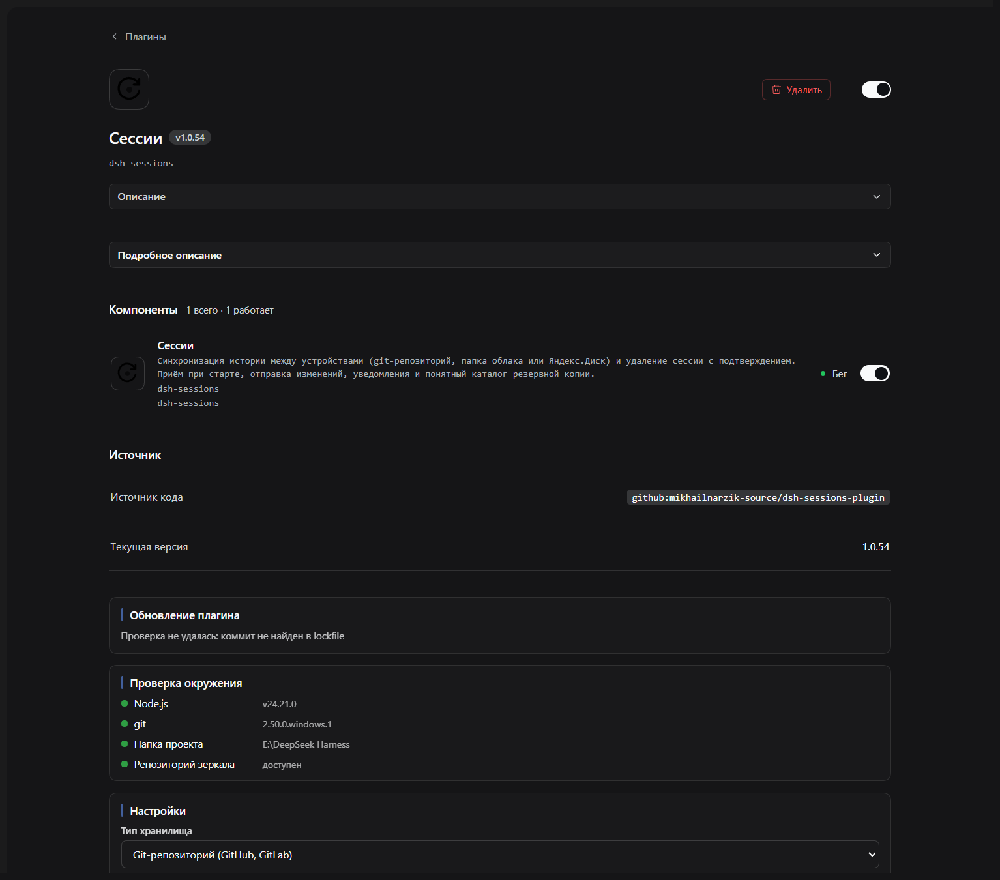

# Синхронизация и удаление сессий — подробно

Подробное описание плагина «Сессии» для DeepSeek Harness. Если вы впервые
настраиваете синхронизацию, начните с `README.md`: там короткие шаги. Здесь —
то же самое, но с деталями: как устроено зеркало, что происходит само, какие
файлы появляются и что делать при ошибках.

## Что это и зачем

**Сессия** — один диалог с агентом: сообщения, вложения, служебные события и
папка проекта (workspace), к которой он привязан. Сессии лежат в
`~/.dsh/sessions`, поэтому на другом компьютере их нет.

**Зеркало** — переносимая копия сессий с нейтральными путями. На каждом
устройстве зеркало одно и то же, а локальный путь к проекту подставляется при
приёме. Так история не зависит от того, что на одном компьютере проект лежит в
`C:\work\app`, а на другом — в `/Users/me/app`.

Плагин закрывает две задачи:

1. **Синхронизация** — держит историю одинаковой на всех устройствах: приём
   при старте и по расписанию, отправка изменений, резервное хранилище,
   уведомления и автообновление.
2. **Удаление** — пункт «Удалить сессию» в меню сессии: проверка связанных
   сессий, подтверждение словом `delete`, по желанию удаление созданных
   сессией файлов проекта.

Механизмы независимы: у каждого свои маршруты и своя область отказа. Сбой
синхронизации не мешает удалению, и наоборот.

Термины:

- **Хранилище** — куда уезжает зеркало: приватный git-репозиторий, папка
  облачного диска, Яндекс.Диск по WebDAV или через API.
- **Резервное хранилище** — второе место для дублирования (git или WebDAV).
- **Идентификатор проекта** — короткое имя проекта (`harness`, `work`),
  одинаковое на всех устройствах. Не путайте с путём: путь у каждого свой.
- **Вложения** — объекты из `~/.dsh/attachments/v1`: картинки и файлы чата.

## Как открыть

1. Плагин ставится как обычный плагин DSH. После установки перезапустите DSH.
2. В левой панели откройте **«Плагины»**.
3. Найдите карточку **«Сессии»** (подпись «Сессии», описание про синхронизацию)
   и откройте страницу плагина.
4. На странице плагина разверните раздел **«Синхронизация сессий»**.

Другие входы:

- отдельный пункт **«Синхронизация сессий»** в левой панели — страница с
  шапкой (иконка, название, статус-чип, «Обновить») и карточками
  «Синхронизация», «Подключение», «Дополнительно», «Проверка окружения»,
  «Обслуживание»; контент центрируется по окну (колонка до 940 px);
- **меню сессии** в левой панели → «Удалить сессию» (для удаления);
- плашка состояния у поля ввода в открытом диалоге;
- агенту доступны инструменты `sync_status` и `sync_run` — можно попросить
  «проверь состояние синхронизации» или «синхронизируй сессии».

## Как пользоваться пошагово

### Шаг 1. Выбрать хранилище

| Хранилище | Что нужно | Когда удобно |
|---|---|---|
| Git-репозиторий | приватный репозиторий, вход в GitHub | есть история версий, работает быстро |
| Папка облака | клиент Яндекс.Диска или OneDrive | без токенов, передачей занимается клиент |
| Яндекс.Диск (WebDAV) | логин и пароль приложения | без установки программы |
| Яндекс.Диск (API) | OAuth-токен | если нельзя поставить клиент и нет WebDAV |

Тип хранилища выбирается один раз и хранится в `~/.dsh/dsh-sync.json`. Сменить
можно в любой момент: нажмите «Сохранить» — следующие запуски пойдут по-новому.

### Шаг 2. Заполнить настройки

1. **Тип хранилища** — один из четырёх вариантов выше.
2. **Адрес репозитория с сессиями (приватный)** — для git.
3. **Путь к проекту на этом компьютере** — папка, в которой вы работаете.
   Заполняется сама из первого workspace DSH, но можно поправить.
4. **Идентификатор проекта** — короткое имя; на втором устройстве должно быть
   точно таким же.
5. **Синхронизировать вложения** — включите, если нужны картинки из чата.
6. **Резервное хранилище (дублирование)** — по желанию: git-репозиторий или
   Яндекс.Диск по WebDAV.
7. **Предпочитать внешний плагин** — оставьте включённым, если стоит другой
   плагин синхронизации с программным интерфейсом; тогда работа пойдёт через
   него.

Для Яндекс.Диска нажмите **«Проверить доступ»**: плагин проверит логин,
пароль приложения или токен и папку. Для git состояние видно в «Проверке
окружения»: строка «Репозиторий зеркала».

### Шаг 3. Сохранить и синхронизировать

1. Нажмите **«Сохранить»**.
2. Нажмите **«Синхронизировать»** (принять и отправить), либо «Только принять»
   / «Только отправить».
3. Дождитесь отчёта: «импортировано», «обновлено», «конфликтов», «вложений
   восстановлено».

**Результат:** в «Проверке окружения» все строки зелёные, в «Синхронизации»
есть запись последнего запуска, точки перед сессиями стали зелёными.

### Шаг 4. Подключить второе устройство

1. Установите DSH и плагин на второй компьютер.
2. Укажите то же хранилище (тот же адрес репозитория или ту же облачную папку).
3. Заполните **локальный** путь к проекту и тот же идентификатор проекта.
4. Нажмите «Сохранить» и «Только принять».
5. Перезапустите DSH.

**Результат:** на втором устройстве появился workspace с вашим локальным путём
и сессиями из зеркала. Откройте любую — история сообщений на месте, новые
сообщения отправляются.

### Шаг 5. Удалить сессию

1. Меню сессии в левой панели → «Удалить сессию».
2. Плагин проверит связанные (дочерние) сессии и файлы, которые создала сессия.
3. Введите слово `delete` и нажмите «Да».
4. При необходимости отметьте «Также удалить файлы, созданные этой сессией».

**Результат:** сессия исчезла из списка, копия лежит в
`~/.dsh/dsh-sync/deleted/<время>/`, а удаление в течение нескольких секунд
уехало в зеркало. На других устройствах сессия исчезнет при следующем приёме.
В зеркале появляется отметка в `tombstones.json`, чтобы удаление не «вернулось»
обратно.

### Шаг 6. Перенести профиль

1. Откройте «Сессии» → «Профиль и рабочие пространства»; блок покажет, что
   найдено в локальном профиле и что лежит в зеркале.
2. Нажмите «Синхронизировать» на странице — в зеркало уедут `profile/`:
   тема/шрифт (`ui-theme`), язык (`locale`), MCP-серверы (`mcp-manager`),
   список включённых плагинов и настройки плагинов по белому списку.
3. На втором устройстве — «Только принять»: безопасные записи `cordis.patch.yml`
   вливаются в локальный файл, пути берутся местные, прочие строки патча
   (комментарии, `insert`, `!!js`) не трогаются.
4. Конфликты видны в «Журнале конфликтов»: локальная копия не затирается,
   следующая отправка рассылает её.

**Результат:** оформление, язык, MCP и настройки плагинов совпадают на
устройствах, а секреты и машинные поля остаются своими у каждого компьютера.

### Шаг 7. Режим «локальная / облачная»

1. Меню сессии → «Сделать локальной»: сессия остаётся только здесь.
2. Вернуть: меню → «Сделать облачной».
3. Массово: карточка «Сессии и режим синхронизации» — фильтр, галочки, кнопки
   «Сделать локальными» / «Сделать облачными», кнопка «Привязать непривязанные».

**Результат:** локальная сессия не отправляется, не принимается и не удаляется
отметкой с другого устройства; значок перед названием становится серым.

## Примеры

### Git-репозиторий

```
адрес:      https://github.com/you/dsh-sessions.git
проект:     C:\work\my-project
id проекта: my-project
```

Если репозитория нет, нажмите «Создать репозиторий»: плагин создаст приватный
репозиторий в вашем аккаунте через GitHub-токен из хранилища DSH и сразу
запустит синхронизацию. Без токена останется ввести адрес вручную.

### Папка облака

```
путь: C:\Users\you\YandexDisk\dsh-sync
```

Подойдёт OneDrive, Яндекс.Диск, iCloud Drive, Syncthing и сетевая папка.
Git не нужен вообще: файлы кладутся прямо в синхронизируемый каталог.

### Яндекс.Диск по WebDAV

1. Откройте `id.yandex.ru` → «Пароли приложений».
2. Создайте пароль типа **«Файлы»** — это и есть WebDAV.
3. В карточке выберите «Яндекс.Диск (WebDAV, пароль приложения)».
4. Логин — имя аккаунта без `@yandex.ru`, пароль — только что созданный.
5. Папка на Диске — `dsh-sync` (создастся сама).
6. «Проверить доступ» → «Сохранить».

### Яндекс.Диск через API

Нужен OAuth-токен с правами на чтение и запись Диска. Токен вставляется в
карточку и сохраняется в `~/.dsh/dsh-sync.json` на этом устройстве (в зеркало
он не попадает). Особенность: синхронизация идёт, только пока DSH запущен.

### Настройки автосинхронизации

Файл `~/.dsh/dsh-sync.json`:

```json
"autoSync": {
  "enabled": true,
  "pullOnStart": true,
  "pushOnChange": true,
  "pushMinIntervalMinutes": 5,
  "pullIntervalMinutes": 15
}
```

### Команды

```powershell
node cli.mjs status                 # счётчики: локально / в зеркале
node cli.mjs diagnostics            # отчёт о состоянии и сохранение
node cli.mjs repair                 # починить копии после конфликтов
node cli.mjs prune-attachments      # убрать неиспользуемые вложения
node cli.mjs compact --months 36    # свернуть историю старше трёх лет
node cli.mjs device list            # какие устройства писали в зеркало
node cli.mjs device forget <id>     # забыть устройство
```

Ключ `--home <каталог>` задаёт другой каталог DSH (по умолчанию `~/.dsh`).

### Фразы агенту

- «Проверь состояние синхронизации» → `sync_status`;
- «Синхронизируй сессии» → `sync_run` (режим `sync`);
- «Прими изменения с других устройств» → `sync_run` с `pull`;
- «Отправь изменения» → `sync_run` с `push`.

## Что вы увидите

**Разделы страницы:**

- Шапка — иконка синхронизации в круге, название, подзаголовок, статус-чип
  («настроено», «не настроено», «проверка…»), время последней синхронизации
  и кнопка «Обновить».
- «Синхронизация» — прогресс по основному и резервному хранилищу, кнопки
  «Синхронизировать», «Только принять», «Только отправить», «Обновить»,
  строка последнего запуска и история запусков.
- «Подключение» — тип хранилища, адрес репозитория (или папка Диска), путь и
  идентификатор проекта.
- «Дополнительно» — вложения, автообновление плагина, резервное хранилище.
- «Проверка окружения» — строки с точкой: Node.js, git, папка проекта,
  репозиторий зеркала, Яндекс.Диск (API или WebDAV).
- «Сессии и режим синхронизации» — фильтр «все / облачные / локальные / требуют
  внимания», список сессий с галочками, режимом и значком состояния, массовые
  кнопки «Сделать локальными» / «Сделать облачными», «Привязать непривязанные».
- «Профиль и рабочие пространства» — найденный профиль, что лежит в зеркале,
  журнал конфликтов, подсказки «не привязана» с кнопкой «Привязать».
- «Обслуживание» — статус версии и кнопка «Обновить».
- «Внешний плагин синхронизации» — найден ли другой плагин синхронизации и
  какой режим выбран.
- Панель действий внизу — «Сохранить», «Создать репозиторий», «Диагностика».

Страница центрируется по окну: контейнер до 940 px с симметричными полями
(24 px, на узком экране — 16 px), у всех карточек единые отступы и радиусы,
цвета берутся из токенов темы `--dsw-alias-*`, поэтому светлая и тёмная темы
выглядят одинаково аккуратно.

**В остальном интерфейсе:**

- индикатор на странице пункта «Синхронизация сессий»: зелёный — успешно,
  жёлтый — идёт работа, красный — ошибка;
- точка перед каждой сессией: зелёная — совпадает с зеркалом, оранжевая — есть
  неотправленные изменения, красная — ещё не отправлялась или конфликт,
  серая — локальная (не синхронизируется), жёлтая — облако недоступно
  (последняя синхронизация не удалась), фиолетовая — не привязана к рабочему
  пространству;
- пункт «Сделать локальной / Сделать облачной» в меню сессии;
- плашка у поля ввода («синхронизировано», «есть изменения», «резерв N%»);
  при наведении — карточка с двумя хранилищами;
- уведомления в правом нижнем углу: красные — ошибка, синие — новая версия,
  зелёные — приняты новые сессии; проверка новой версии идёт через 30 секунд
  после старта и дальше раз в 6 часов, при автообновлении пакет
  переустанавливается сам;
- окно «что нового» после автообновления плагина.

**В зеркале:**

- `projects.json` — список проектов, чтобы новое устройство нашло свои папки;
- `sessions/<проект>/index.md` — таблица сессий проекта с названиями и датами;
- `sessions/<проект>/<сессия>/session.json` — название, дата, размер и
  вложения, рядом лежит сам лог `session.v4.jsonl.zstd`;
- `attachments/` — файлы и картинки из чата, с `README.md` о том, что к чему
  относится;
- `profile/cordis.patch.yml` — только безопасные записи: тема/шрифт, язык, MCP
  (пути заменены на `${HOME}`/`${DSH_HOME}`);
- `profile/bundles.json` — `dsh.profile.bundles`: какие плагины включены;
- `profile/settings/<плагин>.json` — настройки плагинов по белому списку;
- `profile/conflicts.json` — журнал конфликтов профиля (что и почему не
  применилось);
- `workspace.json` — рабочие пространства: путь (нейтрализованный или
  идентификатор проекта), название и список сессий; глобальные поля DSH
  (закреплённые, архив, пространство по умолчанию) не переносятся;
- `README.md` в корне — как читать зеркало и восстановить сессии без DSH.


## Как это выглядит



*Рисунок 1. Страница плагина: описание, настройки и кнопки (скриншот прежнего
оформления; новая страница синхронизации — центрированная колонка до 960 px
с карточками «Подключение», «Дополнительно», «Проверка окружения»,
«Обслуживание»).*


*Рисунок 2. Рабочий раздел плагина: органы управления и результат.*

Кнопки оформлены единой системой (`.tools/plugin-design-spec-v2.md`): высота
36 px (в шапке 32), `padding: 0 14px`, радиус 10, шрифт 600 12.5, ширина по
тексту. Primary — мягкая заливка brand 18%, рамка brand 55%, текст brand;
secondary — прозрачный фон с рамкой `border-l4`; danger — мягкая красная
заливка. Белый фон с белым текстом запрещён: в тёмной теме brand белый, поэтому
старые кнопки `button-primary-fill` не читались. Диалог удаления сессии (`dshsd`)
использует ту же систему, кнопки футера переносятся, на 640 px могут
растягиваться. Страница синхронизации центрирована до 960 px; на 900 px —
одна колонка, на 640 px — компактные поля; длинные строки переносятся, у
широких блоков своя прокрутка.

## Профильный слой, рабочие пространства и режим сессии

Три независимых механизма, каждый со своим файлом и своей областью отказа:
сбой профиля не отменяет отправку сессий, а сбой привязки — приём профиля.

### Профильный слой

| Что | Откуда | Куда в зеркале |
|---|---|---|
| Безопасные ключи патча | `~/.dsh/profiles/<профиль>/cordis.patch.yml` | `profile/cordis.patch.yml` |
| Включённые плагины | `<профиль>/package.json` → `dsh.profile.bundles` | `profile/bundles.json` |
| Настройки плагинов | файлы и браузерный localStorage по белому списку | `profile/settings/<плагин>.json` |
| Журнал конфликтов | приём/отправка | `profile/conflicts.json` |

Белый список `cordis.patch.yml`: записи `ui-theme` (`preference`, `fontSize`,
`textFontSize`, `codeFontSize`, `terminalFontSize`, `*FontFamily`), `locale`
(`preference`) и `mcp-manager` (`servers`). Всё остальное — модели, отключения
плагинов, встроенные сервисы (`ui-settings`, `ui-chat`, `agent-default-model`,
`ui-settings-account` и т. п.) — остаётся машинным и не синхронизируется.

Белый список настроек плагинов: `dsh-notify` (`settings.json`),
`dsh-calendar` (`data.json`), `dsh-expenses` (`rates.json` — только курсы,
временные метки кеша отбрасываются), `dsh-polish` и `dsh-cards` (браузерные
`dsh-polish:enabled` и `dsh-polish:panel-visibility`; их приносит клиент
host-части, потому что localStorage не виден из host-процесса).

Нейтрализация путей: перед записью в зеркало локальный домашний каталог
заменяется на `${HOME}`, каталог DSH — на `${DSH_HOME}`, затем строки проходят
через фильтр машинных ключей (`deviceId`, `token`, `password`, `path` и т. п.).
При приёме токены заменяются обратно локальными путями; написание на диск
зависит от платформы, поэтому в зеркале пути всегда с прямыми слэшами.

Базис обмена: хеши применённых единиц лежат в `~/.dsh/dsh-sync/profile-base.json`.
Если и локальная, и удалённая копия изменились с прошлого обмена (и
различаются), применяется локальная копия, а запись попадает в журнал
`profile/conflicts.json`. Поэтому настройки не теряются молча: журнал
показывается в панели, а следующая отправка рассылает локальный вариант.
Записи плагинов при приёме не заменяются целиком: известные ключи
обновляются, неизвестные локальные остаются.

Включённые плагины при приёме только **добавляются**, и только если пакет
установлен в профиле; ничего не удаляется, чтобы чужой компьютер не остался без
рабочих плагинов. Зависимости из `package.json` (там бывают git-адреса) в
зеркало не переносятся.

### Рабочие пространства

Локальный стор `~/.dsh/storages/workspace.json` — «unit» DSH с таблицей
`workspaces` (`path`, `title`, `sessionIds`) и глобальными полями. В зеркало
уходит `workspace.json`:

```json
{
  "version": 1,
  "workspaces": [
    { "path": "/dsh-sync/projects/alpha", "projectId": "alpha", "title": "Alpha", "sessionIds": ["session-…"] }
  ]
}
```

- путь проекта, известного плагину, заменяется нейтральным
  `/dsh-sync/projects/<id>`; для остальных путей нейтрализуются `${HOME}`-части;
- `defaultWorkspaceId`, `pinnedSessionIds`, `archivedSessionIds`,
  `workspaceIds` и идентификаторы самих рабочих пространств не переносятся;
- при отправке список сессий объединяется с уже лежащим в зеркале — записи
  другого устройства не теряются;
- при приёме стор DSH не переписывается: строится план (совпадение по
  `projectId`, по пути после подстановки, затем по имени последней папки),
  который host-часть применяет через `workspaceRegistry.attachSession()` после
  синхронизации. Несовпавшие записи показываются подсказкой «не привязана» с
  кнопкой «Привязать».

### Режим сессии «локальная / облачная»

Режим хранится в `~/.dsh/dsh-sync/session-modes.json`:

```json
{ "version": 1, "updatedAt": "…", "sessions": { "session-…": "local" } }
```

Отсутствие записи означает «облачная». Локальные сессии:

- не отправляются (в отчёте `локальных сессий не отправлено: N`);
- не принимаются и не перезаписываются при приёме;
- не попадают в состояние отправки, поэтому не считаются «удалёнными» и не
  получают надгробий при переключении режима;
- не удаляются отметкой другого устройства;
- получают серый значок и режим «локальная» в списке панели.

Значки сессии: `synced` (зелёный), `pending` (оранжевый), `never` (красный),
`local` (серый), `conflict` (красный), `offline` (жёлтый — последняя
синхронизация не удалась), `unattached` (фиолетовый — нет привязки к рабочему
пространству). Переключение: меню сессии или массовые кнопки в карточке
«Сессии и режим синхронизации».

## Частые ошибки и что делать

| Симптом | Причина | Решение |
|---|---|---|
| «не настроено» | Нет адреса репозитория или пути проекта | Заполнить поля и нажать «Сохранить» |
| «git не найден» | Git не установлен или не в PATH | Установить git, перезапустить DSH |
| «Репозиторий недоступен» | Нет сети, нет доступа или опечатка в адресе | Проверить адрес, войти в GitHub, нажать «Диагностика» |
| «403/401» у GitHub | Токен просрочен или нет прав на репозиторий | Обновить токен в настройках GitHub-плагина |
| «401» у Яндекс.Диска | Введён пароль аккаунта вместо пароля приложения | Создать пароль приложения типа «Файлы» |
| «Маршрут недоступен — перезапустите DSH» | Интерфейс загрузился раньше host-части | Перезапустить DSH |
| «Маршрут проверки недоступен» | Старая версия host-части | Перезапустить DSH, обновить плагин |
| «Второй плагин синхронизации» | Установлены два движка | Оставить один: «Сессии» **или** dsh-sync |
| Новые сессии не появились | Сессии регистрируются на старте | Перезапустить DSH |
| «открыто: N» | Сессии открыты в этот момент | Закрыть DSH и повторить приём |
| «конфликтов: N» | Одну сессию правили на двух устройствах | Ничего не делать: приехала отдельная копия |
| У копии нет названия | У копии новый id, а события ссылаются на старый | Выполнить `node cli.mjs repair` |
| «Не удалось отправить» | Временная ошибка сети | Повторится через минуту; проверить «Диагностику» |
| Удаление не уехало | Нет синхронизации или ждёт отправки | Дождаться автоотправки или нажать «Синхронизировать» |
| «Не удалось закрыть сессию» | Сессия открыта и не закрывается | Закрыть вручную и повторить удаление |
| «Удаление N сессий ждёт подтверждения» | Удаление превысило порог: больше 5 сессий или больше 20% известных за прогон | Нажать «Подтвердить удаление (N)» в карточке, если удаление действительно нужно |
| «удаляется родитель с субагентами» | Удаляемая сессия — родитель дочерних | Проверить список детей; их копии остаются в зеркале |
| «зеркало не перезаписано» | Локальный лог короче зеркального или разошёлся с ним | Синхронизировать ещё раз; зеркало сохранило больше событий, потерять их плагин не дал |
| «приём пропущен, обновите DSH» | Зеркало писала более новая версия DSH с другим форматом логов | Обновить DSH на этом устройстве |
| «Профиль не найден» | Нет каталога `~/.dsh/profiles/<профиль>` или он вне текущего `DSH_HOME` | Проверить профиль DSH; сессии синхронизируются и без профильного слоя |
| «Настройки сохранены, но приём пропущен: конфликт» | Настройку меняли на двух устройствах | Ничего не делать: локальная версия сохранена и уедет следующей отправкой; журнал в панели |
| «плагин не установлен в этом профиле» | В зеркале включён плагин, которого здесь нет | Установить плагин через менеджер плагинов; список не меняется автоматически |
| «Сессия не привязана» | Сессия приехала с другого устройства, а папки проекта здесь ещё нет | Открыть папку в DSH и нажать «Привязать» |
| «Локальная сессия» вместо зелёной точки | Сессия переведена в режим «локальная» | Вернуть в облако через меню сессии или массово |

Кнопка **«Диагностика»** собирает отчёт (версия Node.js, git, конфигурация,
доступность хранилища) и копирует его в буфер обмена — этот текст удобно
приложить к вопросу.

## Ограничения и безопасность

- **Приватность.** В зеркале лежит вся переписка и содержимое файлов. Репозиторий
  и облачная папка должны быть приватными. Шифрования содержимого нет: сейф
  секретов — отдельный плагин `dsh-vault`.
- **Токены.** GITHUB_TOKEN плагин берёт из хранилища секретов DSH (или из
  переменной окружения `GITHUB_TOKEN`) и передаёт git напрямую флагом
  `-c http.extraHeader=Authorization: Basic x-access-token:<токен>` — без
  credential helper и без sh (все вызовы идут с `shell: false`). В файлы
  настроек и в зеркало токен не попадает. Пароли приложений WebDAV лежат в
  защищённом хранилище секретов DSH, OAuth-токен Яндекс.Диска (API) — в
  `~/.dsh/dsh-sync.json` на этом устройстве, в зеркало он не попадает.
- **Таймауты и ретраи.** Каждая git-операция ограничена таймаутом: обычная —
  45 с, fetch/pull — 60 с, push с загрузкой файлов — 120 с. Зависший git
  убивается вместе с деревом процессов (`taskkill /T /F` на Windows). Сетевые
  сбои (schannel/TLS, таймаут, «fetch failed», обрыв соединения) у fetch и
  push повторяются до 3 раз, у WebDAV — до 4 раз, с нарастающей паузой;
  загрузка одного файла на Яндекс.Диск ограничена 120 с, у ответов 429/503
  уважается Retry-After.
- **Лок.** Межпроцессный лок синхронизации живёт на pid + heartbeat: владелец
  обновляет время в `~/.dsh/dsh-sync/sync.lock/owner.json` раз в минуту, а
  чужой процесс снимает лок автоматически, если владелец умер или молчит
  дольше 5 минут.
- **Перезапуск.** Новые сессии и заголовки появляются в списке DSH после
  перезапуска приложения.
- **Вложения.** Дублируются только в основное хранилище. Если основное
  недоступно, вложения не приедут, пока оно не вернётся. Файлы адресуются по
  sha256, поэтому копируются только недостающие; кеш запросов и `tmp` в зеркало
  не попадают.
- **Одновременная правка.** Если одну сессию правили на двух машинах, локальная
  остаётся нетронутой, а удалённая версия приезжает отдельной сессией. Молча
  ничего не перезаписывается.
- **Открытые сессии.** При приёме они пропускаются (`открыто: N`). Перед
  перезаписью лога делается копия в `~/.dsh/dsh-sync/backups/`.
- **Скорость.** Первая выгрузка большой истории через WebDAV или API может
  занять часы; дальше уходят только изменения.
- **Облачная папка.** Клиент облака передаёт файлы с задержкой; «конфликтующие
  копии» файлов плагин игнорирует.
- **Удаление.** Копия удалённой сессии остаётся в `~/.dsh/dsh-sync/deleted/`.
  Удаление файлов проекта необратимо. Файлы удаляются, только если они созданы
  самой сессией и всё ещё лежат внутри папки проекта.
- **Защита от массового удаления.** За один прогон без явного подтверждения
  нельзя удалить больше 5 сессий или больше 20% известных устройству: плагин
  останавливает удаление и ждёт кнопки «Подтвердить удаление (N)». Если каталог
  сессий или каталог именно этого проекта недоступен, удаление из зеркала
  пропускается — сломанный доступ не считается «всё удалили».
- **Карантин зеркала.** Удалённое из зеркала не стирается сразу: 30 дней лежит
  в `sessions/<проект>/_deleted/<id>/` вместе с `deleted-at.json` (время и
  причина), затем вычищается. Восстановить можно простым переносом папки.
- **Журнал удалений.** Каждый запуск пишется в `~/.dsh/dsh-sync/history.jsonl`;
  у записей с удалением есть поля `removed`, `removedIds` и `removedReason`.
  Карточка показывает строку «Удалено: N — причина».
- **Push-guard.** Если локальный лог короче зеркального или разошёлся с ним,
  зеркало не перезаписывается: иначе пропали бы события, которые другое
  устройство уже получило. В отчёте такие сессии помечаются отдельно.
- **Сверка версий DSH.** Зеркало хранит версию и формат DSH в `projects.json`
  (`dsh.version`/`dsh.format`). Логи более нового формата старый DSH не
  получает (приём останавливается с предупреждением), более новая версия при
  том же формате — предупреждение, но приём продолжается. Отметку старого
  приложения зеркало не затирает.
- **Субагенты.** Связи родитель/дети пишутся в `session.json` каждой сессии
  (`parent`, `children`); в карточке — счётчик «Субагентов: N, доступны M»;
  удаление родителя с детьми в зеркале сопровождается предупреждением.
- **Профильный слой.** В зеркало уходят только безопасные ключи и настройки по
  белому списку. Секреты, токены, `browser-secrets.env`, `dsh-inbox/device.json`,
  идентификаторы устройства и абсолютные пути не переносятся; пути заменяются
  на `${HOME}`/`${DSH_HOME}`. При приёме локальный `cordis.patch.yml`
  изменяется только в адресованных записях: комментарии, `insert` и `!!js`
  сохраняются, перед изменением делается копия в
  `<профиль>/.dsh-sync-backup/`.
- **Конфликты профиля.** Обе стороны изменились — приоритет у локальной копии,
  случай пишется в `profile/conflicts.json` (последние 200 записей). Молча
  ничего не затирается.
- **Сброс настройки.** Переносятся заданные безопасные ключи; если на другом
  устройстве настройку убрали (вернули значение по умолчанию), локальная строка
  не удаляется. Сбросьте её вручную в настройках DSH — следующая отправка
  разошлёт изменение.
- **MCP и секреты.** Из MCP-серверов переносятся `transport`, `command`, `args`,
  `enabled`, таймауты; ключи с секретами и переменными окружения (`env`,
  `headers`, `token`, `password` и т. п.) отбрасываются рекурсивно. Если токен
  вписан прямо в `args`/URL сервера, он попадёт в зеркало: храните секреты в
  `browser-secrets.env` и ссылайтесь на файл.
- **Локальный режим.** Обещание «только на этом устройстве»: сессия не
  отправляется, не принимается, не удаляется чужими отметками и не даёт
  надгробий. Режим — настройка устройства, в зеркало не попадает.
- **Привязка рабочих пространств.** Стор DSH при приёме не переписывается:
  план привязки применяет host-часть через реестр после синхронизации. Если
  рабочего пространства с таким путём нет — запись остаётся подсказкой, данные
  не теряются.
- **Служебные файлы.** `~/.dsh/dsh-sync/state.json` можно удалить (следующий
  push просто запомнит состав заново); конфигурацию `~/.dsh/dsh-sync.json`
  можно править руками; `ledger.json` — реестр для точек состояния;
  `session-modes.json` — режимы сессий; `profile-base.json` — базис обмена
  профиля; `workspace-pending.json` — очередь привязки, её применяет host.

## Связанные плагины

- **dsh-sync** — отдельный плагин только для синхронизации, без удаления.
  Не ставьте его вместе с «Сессиями»: два движка будут писать в одно зеркало.
- **dsh-session-delete** — отдельный плагин только для удаления. То же самое
  уже встроено в «Сессии».
- **dsh-sessions-bundle** — пакет, который ставит старые отдельные плагины
  синхронизации и удаления одним действием.
- **dsh-github-safe** — хранит GitHub-токен, нужен кнопке «Создать репозиторий».
- **dsh-vault** — зашифрованный сейф ключей и паролей; у него свой git-репозиторий
  и свой файл, с зеркалом сессий он не смешивается.
